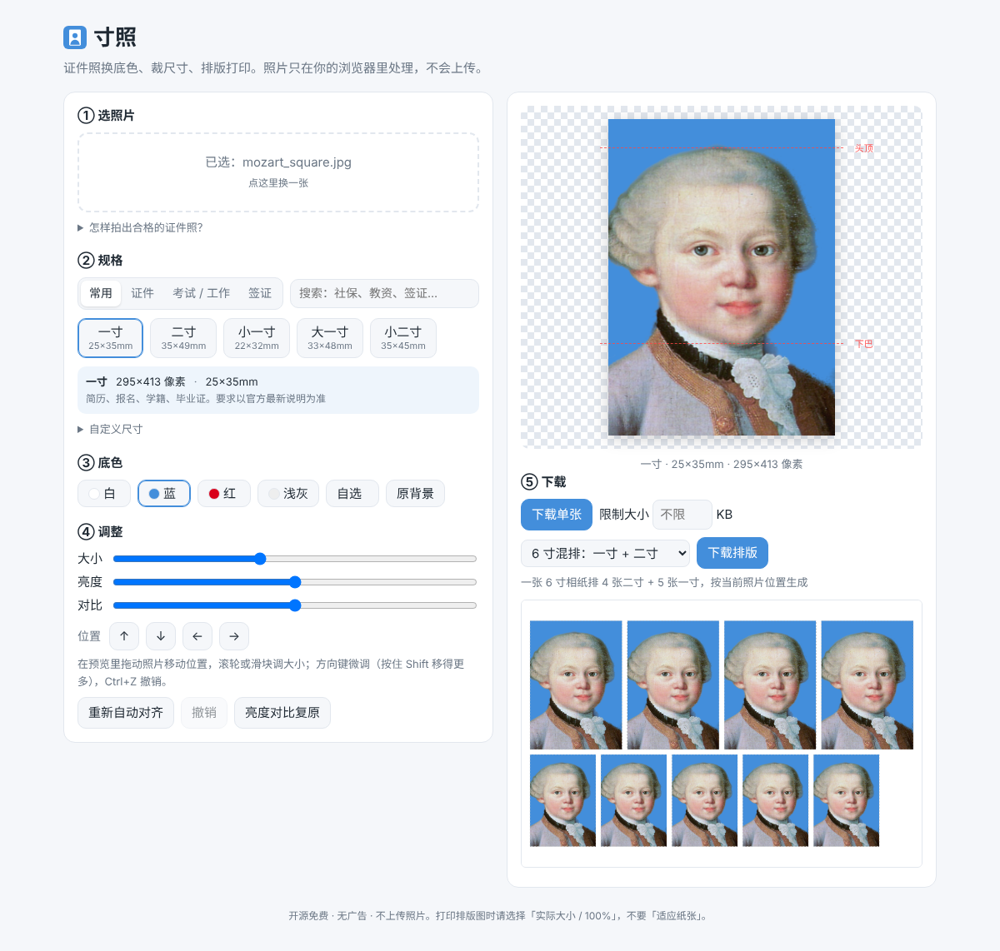
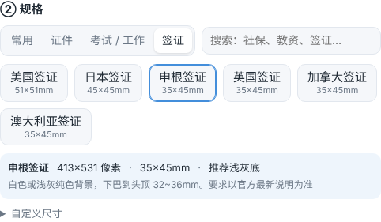
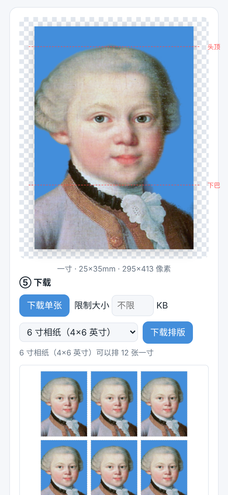
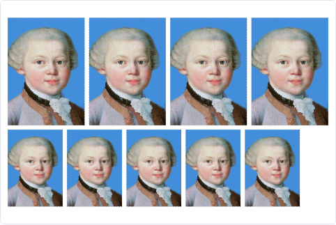

# 寸照 · 免费证件照排版



**在线使用：<https://ash-ze.github.io/cunzhao/>**

在浏览器里做证件照：换底色、裁成一寸 / 二寸 / 社保卡 / 教资 / 签证等规格、排版到 6 寸相纸拿去冲印、压缩到报名网站要求的 KB 大小。

**照片不上传。** 人脸识别和抠图都在你的浏览器里用 WebAssembly 跑，网页关掉什么都不留。没有广告，不收费，不用注册。

## 功能

- **19 种常用规格，分类 + 搜索**：
  - 常用：一寸、二寸、小一寸、大一寸、小二寸
  - 证件：身份证、社保卡、护照 / 港澳通行证、驾驶证、结婚登记（双人合影 53×35mm）
  - 考试 / 工作：教师资格证、公务员 / 考试报名、健康证
  - 签证：美国、日本、申根、英国、加拿大、澳大利亚
  - 也可以自定义毫米尺寸；搜「社保」「教资」「国考」「35x45」都能找到
- **选中规格就显示要点**：像素、毫米、推荐底色、文件大小上限。没手动选过底色时自动换成推荐底色，有 KB 要求的自动填好压缩上限
- **手机直接自拍**：手机上有「用前置摄像头自拍」按钮，附拍照小贴士（光线、背景、衣服颜色、手机高度）
- **自动对齐**：识别人脸，按规格把头顶和下巴放到合适位置；结婚登记照会把两个人一起框进来
- **换底色**：白、蓝、红、浅灰、任意颜色，或保留原背景
- **抠图边缘精修**：以原图为引导做彩色导向滤波，头发处保留柔和过渡、衣服边缘收紧，并去掉边缘混进来的原背景色，换底后没有白边、灰边
- **微调**：拖动、滚轮、方向键（Shift 加速）移动和缩放，亮度 / 对比度滑块，「重新自动对齐」可以撤销（Ctrl+Z）
- **下载单张** 300dpi JPG，可限制文件大小（比如考试报名要求 ≤ 50KB）
- **排版打印**：6 寸、5 寸相纸或 A4，自动选最省纸的排法并画出裁切线，按毫米尺寸换算保证冲印出来尺寸准确。6 寸相纸能排 12 张一寸
- **一寸二寸混排**：一张 6 寸相纸上 4 张二寸 + 5 张一寸
- 可以装到手机桌面（PWA），模型下载过一次后离线也能用；首次下载显示进度

| 规格分类和要求说明 | 手机 | 一寸二寸混排 |
| --- | --- | --- |
|  |  |  |

排版原图：[6 寸 12 张一寸](screenshots/print-6inch.jpg) · [6 寸混排](screenshots/print-mix-6inch.jpg)

> 各类证件的要求来自公开说明，地区和年份不同会有差异，提交前请对照官方最新要求。

## 打印提示

把排版图发给冲印店说「6 寸照片」即可。自己打印时请选「实际大小 / 100%」，不要选「适应纸张」，否则尺寸会变。

## 拍照小贴士

- 站在白墙或浅色纯色墙前，人离墙半米以上，避免身后有影子
- 面向窗户用自然光，别让顶灯或侧光在脸上打出阴影
- 手机和眼睛一样高，正对镜头；最好请别人用后置摄像头拍
- 头发别挡住眉毛和耳朵；衣服颜色别和底色一样

## 本地开发

```bash
npm install
npm run dev      # 首次会下载约 16MB 的抠图模型到 public/models
npm test         # 单元测试（规格换算、排版、抠图精修），用 Node 自带的 node:test
npm run build    # 输出到 dist/，纯静态文件
```

## 部署

`dist/` 是纯静态文件，放到任何静态托管都可以：

- **GitHub Pages**：仓库里已带 `.github/workflows/pages.yml`（测试通过后构建），在仓库 Settings → Pages 里把 Source 设成 GitHub Actions，推送到 main 就会自动部署
- **Cloudflare Pages / Netlify / Vercel**：构建命令 `npm run build`，输出目录 `dist`

单个文件最大约 16MB，在 Cloudflare Pages 25MB 的单文件限制以内。部署到别的地址时，记得把 `index.html` 里 `og:url`、`og:image` 的网址改成自己的。

## 技术

- 原生 JS + Vite，没有框架
- 人脸检测：MediaPipe BlazeFace short range
- 人像分割：MediaPipe Selfie Multiclass 256×256（区分头发、皮肤、衣服、背景），用它找到真实头顶来对齐
- 边缘精修（`src/matte.js`，纯 JS）：彩色导向滤波做联合上采样，头发区域用更大的 eps 保留柔和过渡；blur fusion 前景色估计去掉背景色溢出。桌面浏览器上分割 + 精修一般在 1 秒内
- 排版、压缩都用 Canvas

## 已知限制

- 抠图对发丝细节仍然一般，浅色头发配浅色背景、背景杂乱时边缘可能不干净，换一张背景干净的照片效果会好很多
- 规格的头部比例是通用值，个别证件（如部分国家签证）对头部尺寸有精确要求，提交前请对照官方说明
- 结婚登记照需要两人本来就在同一张照片里，不能把两张单人照拼在一起

## 许可

代码 MIT。MediaPipe 及其模型为 Apache-2.0。
